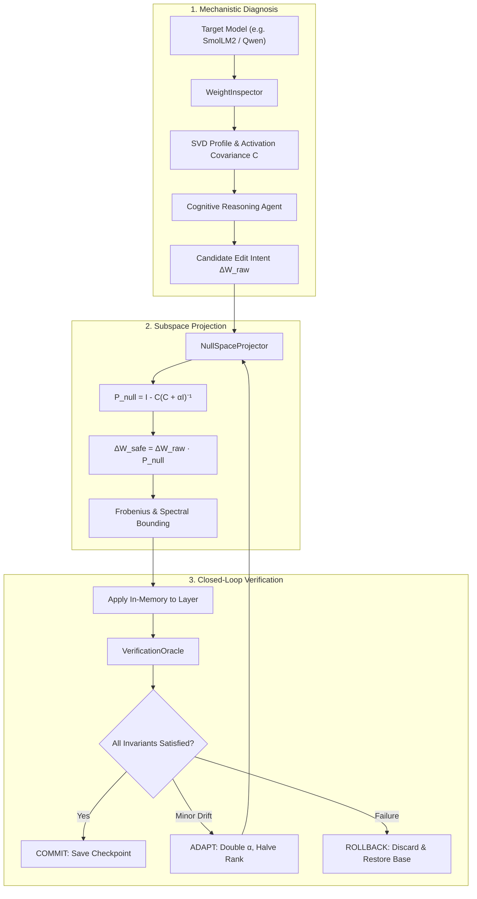

# Beyond Weight-Space Programming (BeyondWSP)
### Towards Reliable, Adaptive, and Self-Verifying Neural Network Editing

[](https://www.python.org/downloads/)
[](https://opensource.org/licenses/MIT)
[](#)

---

## 🔬 Overview

In November 2026, researchers from MIT CSAIL (Rikiya Takehi, Jayden Teoh, Alex Zhang, and Omar Khattab) published *"Sparks of Weight-Space Programming: LLMs can natively read & write neural network weights"*. They demonstrated that frontier LLMs can directly inspect and edit raw neural network weight matrices without gradient descent or training loops—such as subtracting a directional vector from 64 columns in `Qwen3.5-0.8B` to resolve thinking loops.

While a significant conceptual leap, current Weight-Space Programming (WSP) is **unconstrained, heuristic, and prone to unverified collateral damage**. 

**BeyondWSP** introduces **Subspace-Projected & Self-Verifying Weight-Space Programming (SP-SV-WSP)**. By uniting LLM cognitive reasoning with:
1. **Null-Space Projection Algebra** ($P_{\text{null}} = I - C(C + \alpha I)^{-1}$),
2. **Spectral Conditioning & Frobenius Budgeting** ($\|\Delta W\|_F \le \gamma \|W\|_F$), and
3. **An Autonomous Closed-Loop Verification Oracle** (Locality, Perplexity, and Safety Invariants),

we transform Weight-Space Programming from an empirical trial-and-error hack into a mathematically guaranteed, safe, and autonomous engineering discipline.

---

## 📚 Documentation Index

Comprehensive documentation is organized across four specialized treatises in the `docs/` folder:

1. **[Theoretical Foundations & Critique of Takehi et al. (2026)](docs/01_theoretical_foundations.md):**
   Deconstructs the 5 fundamental structural flaws of current WSP (subspace contamination, permutation/gauge ambiguities, spectral collapse, lack of self-verification, and empirical guesswork).
2. **[Mathematical Formulation & Proofs](docs/02_mathematical_formulation.md):**
   Full linear algebraic derivations, Tikhonov regularization, the Invariance Theorem ($\|\Delta W_{\text{safe}} x_{\text{retain}}\| \approx 0$), Weyl's singular value inequality, and the decision boundary equations.
3. **[System Architecture & Software Stack](docs/03_system_architecture.md):**
   Component design of `wsp_core` (`WeightInspector`, `NullSpaceProjector`, `VerificationOracle`, and `CognitiveReasoningAgent`), API definitions, and sequence diagrams.
4. **[Experimental Protocol & Benchmark Suite](docs/04_experimental_protocol.md):**
   Evaluation methodology on an 8GB VRAM envelope (`SmolLM2-360M`, `Pythia-410M`, `Qwen3.5-0.8B`), benchmark datasets (MATH-500, Wikitext-2, Lambada), baselines, and acceptance criteria.

---

## 🚀 Architectural Architecture



---

## 💻 Hardware Compatibility

All algorithms, forward probing loops, and covariance computations are designed to execute smoothly on:
- **GPU:** NVIDIA RTX 4060 Laptop (8GB VRAM)
- **CPU:** AMD Ryzen 7 7840HS
- **RAM:** 16GB
- **OS:** Windows / Linux

---

## 📄 Citation & Attribution

If you utilize this research framework or software, please cite:
```bibtex
@article{beyond_wsp_2026,
  title={Beyond Weight-Space Programming: Towards Reliable, Adaptive, and Self-Verifying Neural Network Editing},
  author={BeyondWSP Research Initiative},
  journal={arXiv preprint},
  year={2026}
}
```

