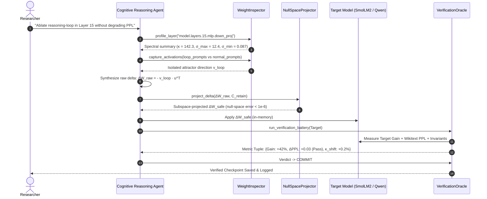

# System Architecture: `wsp_core` Software Stack

## 1. Modular Overview

The `wsp_core` framework is designed as a modular, mathematically rigorous, and reproducible toolkit for Subspace-Projected & Self-Verifying Weight-Space Programming.

```
+-----------------------------------------------------------------------------------+
|                                 wsp_core Framework                                 |
+-----------------------------------------------------------------------------------+
|                                                                                   |
|  +--------------------+   +---------------------+   +--------------------------+  |
|  |  WeightInspector   |   | NullSpaceProjector  |   |    VerificationOracle    |  |
|  |--------------------|   |---------------------|   |--------------------------|  |
|  | - SVD Spectrum     |   | - Covariance Cache  |   | - Target Task Accuracy   |  |
|  | - Activation Probe |   | - Moore-Penrose Inv |   | - Retained PPL Evaluator |  |
|  | - Condition Number |   | - Tikhonov Tuning   |   | - Refusal/Safety Checker |  |
|  | - Pathology Vector |   | - Frobenius Bounding|   | - Automated Rollback     |  |
|  +--------------------+   +---------------------+   +--------------------------+  |
|            ^                         ^                           ^                |
|            |                         |                           |                |
|  +---------+-------------------------+---------------------------+-------------+  |
|  |                           CognitiveReasoningAgent                           |  |
|  |  - Formulates Mechanistic Hypotheses from SVD / Activation geometry         |  |
|  |  - Generates Candidate Directional Tensors ΔW_raw                          |  |
|  |  - Interprets Verification Feedback & Iterates Adaptively                  |  |
|  +-----------------------------------------------------------------------------+  |
|                                                                                   |
+-----------------------------------------------------------------------------------+
```

---

## 2. Component Specifications

### 2.1 `WeightInspector` (`wsp_core/inspector.py`)
Responsible for reading, probing, and diagnostic profiling of model layers without mutating parameters:
- **`profile_layer(layer_name)`**: Computes singular value decomposition $W = U \Sigma V^T$, condition number $\kappa(W)$, spectral energy distribution, and Frobenius norm.
- **`capture_activations(prompt_batch, layer_name, position="last")`**: Registers forward hooks to capture input representations $X \in \mathbb{R}^{d_{\text{in}} \times N}$ and output activations $Y \in \mathbb{R}^{d_{\text{out}} \times N}$.
- **`extract_contrastive_vector(positive_prompts, negative_prompts, layer_name)`**: Computes the mean difference or principal direction separating desired vs. pathological behaviors:
  $$v_{\text{target}} = \mu_{\text{target}} - \mu_{\text{base}} \quad \text{or} \quad \text{Top-1 PCA}\left(X_{\text{target}} - X_{\text{base}}\right)$$

### 2.2 `NullSpaceProjector` (`wsp_core/projector.py`)
Responsible for constructing the safe projection manifold and ensuring zero-interference constraints:
- **`compute_covariance(activations, alpha=1e-3)`**: Computes the sample covariance matrix $C = \frac{1}{N} X X^T$ and applies Tikhonov regularized inversion:
  $$P_{\text{null}} = I - C (C + \alpha I)^{-1}$$
- **`project_delta(delta_w, p_null)`**: Performs orthogonal projection:
  $$\Delta W_{\text{safe}} = \Delta W \cdot P_{\text{null}}$$
- **`enforce_frobenius_budget(delta_w, base_w, gamma=0.02)`**: Enforces the relative perturbation bound:
  $$\|\Delta W_{\text{safe}}\|_F \le \gamma \|W\|_F$$

### 2.3 `VerificationOracle` (`wsp_core/verifier.py`)
Autonomous supervisor that guards against unintended regressions:
- **`evaluate_target_task(model, task_suite)`**: Computes performance gain on target task (e.g., math reasoning completion, loop suppression percentage).
- **`evaluate_retained_perplexity(model, text_corpus)`**: Computes token-level cross-entropy loss $\mathcal{L}_{\text{CE}}$ and exponentiates to calculate perplexity on standard text (Wikitext-2 / OpenWebText sample).
- **`evaluate_safety_invariants(model, safety_prompts)`**: Checks adherence to standard refusal guardrails and calibrated generation.
- **`verdict(metrics, thresholds)`**: Emits `COMMIT`, `ADAPT`, or `ROLLBACK`.
- **`rollback(model, backup_state)`**: Restores pristine layer weights if any invariant fails.

### 2.4 `CognitiveReasoningAgent` (`wsp_core/agent.py`)
The orchestrator that interfaces between diagnostic tools and cognitive reasoning:
- Receives structured diagnostic summaries (spectral profiles, singular values, activation clusters).
- Proposes mechanistic hypotheses (e.g., "Attractor located along left singular vector $u_3$ of layer 15 down-projection").
- Synthesizes candidate tensor deltas $\Delta W_{\text{raw}}$.
- Inspects verification feedback and adapts hyperparameters ($\alpha, \gamma$, rank $r$) if constraints are breached.

---

## 3. Data Flow Diagram



